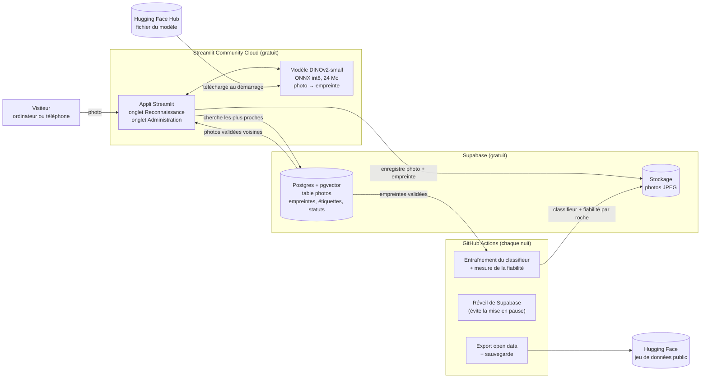
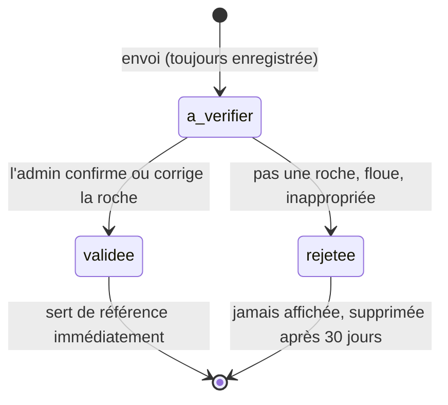

# Plan : reconnaissance de roche par photo

Ajouter au site un onglet **« Reconnaissance par photo »**. On envoie une photo de roche, le site propose les roches qui lui ressemblent le plus, et **chaque photo envoyée enrichit la base** pour que la reconnaissance s'améliore avec le temps.

Ce document décrit l'architecture retenue et le plan de travail par étapes. Rien n'est encore codé.

---

## 1. Le principe en une image

Le cœur du système n'est pas un « cerveau » qu'il faudrait réentraîner à chaque nouvelle photo. On procède plutôt par **comparaison** :

1. Un modèle de vision déjà entraîné (DINOv2, de Meta, licence libre Apache 2.0) transforme chaque photo en une **empreinte** : une liste de 384 nombres qui résume sa texture, ses couleurs et ses formes.
2. La base garde l'empreinte de chaque photo **validée**, avec le nom de la roche.
3. Pour une nouvelle photo, on calcule son empreinte et on cherche **les photos de la base dont l'empreinte est la plus proche**. Les roches les plus représentées parmi ces voisines sont les suggestions (méthode des « k plus proches voisins »).

Ce choix a une conséquence importante : **une photo validée améliore la reconnaissance immédiatement**, sans réentraînement, sans carte graphique et sans frais. C'est exactement le « chaque image enrichit la base » demandé.

Une seconde couche, réentraînée chaque nuit gratuitement par GitHub Actions, affine ensuite les résultats (voir §4).

---

## 2. Contraintes prises en compte

| Contrainte | Conséquence pour l'architecture |
|---|---|
| Aucun service payant | Uniquement des offres gratuites : Streamlit Community Cloud, Supabase (gratuit), GitHub Actions, Hugging Face. Pas d'API d'IA payante. |
| Pas de carte graphique, ni chez toi ni sur Streamlit Cloud | Petit modèle compressé (24 Mo) exécuté sur processeur avec ONNX Runtime, sans PyTorch. Aucun entraînement lourd. |
| Streamlit Cloud : de 690 Mo à 2,7 Go de mémoire selon la doc officielle | Le modèle et ONNX Runtime tiennent en environ 150 Mo de mémoire. Les empreintes sont cherchées par la base de données, pas chargées dans l'appli. |
| Airtable gratuit : 1 000 lignes par base au maximum | Trop petit pour une photothèque. Airtable reste pour le dictionnaire ; les photos vont dans **Supabase**. |
| Photos de l'ENS Lyon : republication soumise à autorisation | La base est construite avec des photos **sous licence libre** : contributions, Wikimedia Commons, et l'ENS seulement si elle donne son accord. |
| Une photo ne suffit pas toujours à identifier une roche (calcaire et dolomie, marbre et quartzite…) | La photo **propose**, la clé d'identification **vérifie**. Les deux onglets sont reliés. |

---

## 3. Parcours d'un visiteur dans le nouvel onglet

1. **Conseils photo** affichés en haut : cassure fraîche, gros plan, lumière du jour sans flash, une pièce de monnaie pour l'échelle.
2. **Accord d'utilisation** (case à cocher, une fois par visite) : « Ma photo sera conservée et pourra être publiée sous licence CC BY 4.0 pour améliorer la reconnaissance. »
3. **Envoi de la photo** : depuis un fichier, ou avec l'appareil photo du téléphone directement sur le terrain (`st.camera_input`).
4. **La photo est enregistrée tout de suite** (statut « à vérifier »), avec son empreinte et la prédiction du modèle. C'est ainsi que *chaque* photo enrichit la base, même si le visiteur s'arrête là.
5. **Résultats** : les 3 roches les plus probables, chacune avec :
   - un indice de ressemblance,
   - les 3 photos validées les plus proches (pour comparer de ses yeux),
   - la définition du dictionnaire,
   - la fiabilité mesurée du modèle pour cette roche (« reconnue correctement 8 fois sur 10 »).

   Un rappel s'affiche toujours : une photo ne suffit pas, il faut vérifier avec la clé.
6. **Si la photo ne ressemble à rien de connu** (ressemblance trop faible) : « Je ne reconnais pas cette image : est-ce bien une roche ? » On propose alors directement la clé.
7. **« Quelle est la bonne réponse ? »** Le visiteur peut :
   - confirmer une des suggestions,
   - **vérifier avec la clé** : l'onglet Identificateur s'ouvre, déjà positionné sur la bonne famille, et le résultat de la clé est rattaché à la photo,
   - choisir une autre roche dans la liste,
   - ou répondre « je ne sais pas ».

   Sa réponse est enregistrée comme **étiquette proposée**.
8. Un administrateur **valide, corrige ou rejette** la photo. Une fois validée, elle sert de référence pour tous les visiteurs suivants.

Bonus : sur la page de résultat de la clé, un bouton **« Ajouter une photo de cette roche »** permet aussi d'enrichir la base, avec une étiquette déjà fiable puisqu'elle vient de la clé.

---

## 4. Architecture

### Ce que fait chaque brique

| Brique | Rôle | Pourquoi ce choix |
|---|---|---|
| **Appli Streamlit** (existante) | Interface, calcul de l'empreinte, affichage des suggestions, administration | Déjà en place, gratuite |
| **DINOv2-small en ONNX int8** | Transforme une photo en empreinte de 384 nombres, en moins d'une seconde sur processeur | Excellent pour comparer des textures, léger (24 Mo), licence libre, pas besoin de PyTorch |
| **Supabase Postgres + pgvector** | Table des photos et recherche des empreintes les plus proches directement dans la base | Gratuit (500 Mo, soit des dizaines de milliers d'empreintes), vraie base de données, tableau de bord qui ressemble à Airtable |
| **Supabase Storage** | Les fichiers JPEG (réduits à 1 024 px, environ 150 Ko) | Gratuit (environ 1 Go selon les sources, soit plusieurs milliers de photos), même service que la base |
| **GitHub Actions** (comme la sauvegarde de la carte) | Chaque nuit : entraîner le classifieur, mesurer la fiabilité, garder Supabase éveillé, exporter les données | Gratuit, déjà utilisé dans le projet |
| **Hugging Face** | Héberge le fichier du modèle et, plus tard, publie la photothèque comme jeu de données ouvert | Gratuit, standard en IA |

### Les deux étages de la reconnaissance

1. **Plus proches voisins** (en direct) : les 10 photos validées les plus ressemblantes votent, pondérées par leur ressemblance. Une photo validée compte **dès la seconde suivante**.
2. **Classifieur linéaire** (réentraîné chaque nuit) : une régression logistique apprise sur toutes les empreintes validées. Elle généralise mieux que les voisins quand une roche a beaucoup d'exemples. L'entraînement dure quelques secondes sur le processeur de GitHub. Le résultat, quelques centaines de Ko de coefficients, est relu par l'appli au démarrage.

Les deux avis sont combinés. Les probabilités sont aussi additionnées **par famille** (sédimentaire, magmatique, métamorphique). Si la roche exacte est incertaine mais que la famille est sûre, on propose de démarrer la clé dans la bonne branche.

### La mesure de fiabilité, pour rester honnête

Chaque nuit, le script d'entraînement mesure la qualité sur les photos validées (validation croisée) :
- le taux de bonne réponse en 1re position et dans les 3 premières, pour chaque roche,
- les confusions les plus fréquentes (« la dolomie est souvent prise pour du calcaire »).

Ces chiffres sont affichés à côté des suggestions. Ils servent aussi à décider objectivement quand une roche a assez d'exemples pour être proposée.

---

## 5. Base de données

### Table `photos` (Supabase)

| Colonne | Contenu |
|---|---|
| `id` | identifiant unique |
| `cree_le` | date d'envoi |
| `chemin_image` | emplacement du JPEG dans le stockage |
| `empreinte_image` | empreinte du fichier (SHA-256), pour refuser les doublons exacts |
| `embedding` | `vector(384)`, l'empreinte DINOv2 |
| `prediction`, `score_prediction` | ce que le modèle a proposé à l'envoi |
| `roche_proposee` | réponse du visiteur (suggestion, clé ou liste) |
| `source_etiquette` | `suggestion acceptée`, `clé d'identification`, `liste`, `inconnue` |
| `statut` | `à vérifier`, `validée` ou `rejetée` |
| `roche_validee`, `validee_le` | décision de l'administrateur |
| `contributeur` | nom ou pseudo (facultatif) |
| `licence`, `consentement` | `CC BY 4.0` et accord coché (obligatoire) |
| `origine` | `contribution`, `wikimedia commons`, `ens lyon`… (avec l'auteur si besoin d'attribution) |

Index HNSW sur `embedding` (distance cosinus). Une fonction SQL `photos_proches(empreinte, nombre)` renvoie les photos **validées** les plus proches. Le script SQL complet sera dans `supabase/schema.sql`.

### Cycle de vie d'une photo

---

## 6. Qualité des données : le point critique

Une base qui s'enrichit toute seule peut aussi s'abîmer toute seule : mauvaises étiquettes, photos floues, images sans rapport. Garde-fous prévus :

- **Seules les photos validées servent de référence et sont affichées publiquement.** Une photo inappropriée n'est jamais visible par les autres visiteurs.
- **Onglet Administration** protégé par un mot de passe (dans les secrets). La file des photos à vérifier montre en premier celles où le modèle et le visiteur ne sont pas d'accord, avec des boutons Valider, Corriger et Rejeter. On peut aussi tout faire depuis le tableau de bord Supabase.
- **Doublons** refusés grâce à l'empreinte du fichier. Les quasi-doublons (même photo recadrée) sont repérés parce qu'ils sont presque identiques au plus proche voisin.
- **Images hors sujet** repérées quand leur ressemblance maximale est trop faible : elles sont marquées pour l'administrateur.
- **Équilibre entre roches** : une roche n'est proposée qu'à partir d'un minimum de photos validées (par exemple 10), et le classifieur compense les roches sur-représentées.
- **Plus tard**, une validation automatique pourrait être envisagée (étiquette venue de la clé, et modèle d'accord avec une forte confiance). Mais seulement si la mesure nocturne montre que cette règle se trompe moins de 5 % du temps.

---

## 7. Légal et sécurité

- **Licence** : chaque contribution est publiée sous CC BY 4.0, avec un accord explicite avant l'envoi. C'est ce qui permet ensuite de partager la photothèque, et à terme de remplacer les photos de l'ENS par des photos libres.
- **Vie privée (RGPD)** : les métadonnées EXIF, dont la position GPS, sont **supprimées** au réenregistrement du JPEG. Le nom est facultatif. Une adresse de contact permet de demander la suppression d'une photo. Une mention est ajoutée à la page Objectif.
- **Secrets** : la clé Supabase « service » et le mot de passe d'administration restent dans les secrets Streamlit, **jamais dans le code**. La sécurité au niveau des lignes (RLS) est activée, sans accès public direct à la base.
- **Fichiers acceptés** : JPEG, PNG ou WebP, 10 Mo au maximum, réduits à 1 024 px côté serveur.
- **Point Supabase à surveiller** : les projets créés depuis le 30 mai 2026 doivent donner explicitement les droits d'accès (`GRANT`) aux tables via l'API. Le script `schema.sql` les inclura.

---

## 8. Amorçage : les premières photos

Sans photos de référence, la reconnaissance ne peut rien proposer. Avant d'ouvrir l'onglet, il faut constituer un premier fonds :

1. **Tes propres photos** et celles de ton entourage (lithothèque de prépa, sorties terrain). C'est la meilleure source : elle est libre et ressemble aux futures photos des visiteurs.
2. **Wikimedia Commons** : des milliers de photos de roches sous licences libres (CC BY, CC BY-SA, domaine public). Un script d'import récupérera l'auteur et la licence de chaque photo. Un tri sera nécessaire, car les catégories contiennent aussi des paysages et des bâtiments.
3. **La lithothèque de l'ENS Lyon**, si elle donne son accord : des photos de qualité, bien étiquetées et couvrant exactement les roches du programme. La demande peut être faite en même temps que celle pour les 22 photos actuelles.

**Objectif avant l'ouverture** : au moins 15 à 20 photos validées pour chacune des 20 à 25 roches les plus courantes. Les autres seront marquées « pas encore assez d'exemples ».

---

## 9. Plan de travail par étapes

Chaque étape se termine par un site qui fonctionne et peut être mis en ligne.

### Étape 0 : préparatifs (ton rôle)
- Mettre en ligne les corrections déjà faites.
- Annuler les anciennes clés Cloudinary et Airtable.
- Créer un compte et un projet **Supabase** gratuits. Créer un compte **Hugging Face** (facultatif au début).
- Écrire à la lithothèque de l'ENS Lyon (je peux rédiger le message).

**Terminé quand** les clés Supabase sont dans les secrets Streamlit.

### Étape 1 : la photothèque participative (sans IA)
- `supabase/schema.sql` : table, stockage, droits.
- Onglet **« Reconnaissance par photo »** en version 1, « Contribuer » : envoi, accord, choix de la roche (liste ou clé), enregistrement.
- Bouton **« Ajouter une photo »** sur le résultat de la clé.
- Onglet **Administration** : valider, corriger, rejeter.
- Galerie **Photothèque** : photos validées par roche, avec auteur et licence.
- Tests automatiques avec une fausse base.

**Terminé quand** une photo va de l'envoi à la galerie, en passant par la validation.

### Étape 2 : amorçage
- Script `outils/import_photos.py` : importe un dossier de tes photos, et les photos Wikimedia Commons avec leur licence.
- Tri et validation dans l'onglet Administration.

**Terminé quand** au moins 15 photos validées existent pour 20 roches.

### Étape 3 : la reconnaissance
- `modele.py` : téléchargement et mise en cache du modèle ONNX, préparation de la photo, calcul de l'empreinte.
- Recherche des plus proches voisins dans Supabase, top 3, photos de comparaison, seuil « hors sujet », lien vers la clé positionnée sur la bonne famille.
- Calcul des empreintes des photos déjà en base.

**Terminé quand** la reconnaissance fonctionne et que sa fiabilité est mesurée (en retirant chaque photo de la base et en vérifiant si elle est reconnue).

### Étape 4 : apprentissage nocturne
- Workflow `.github/workflows/entrainement.yml` : classifieur, mesure de la fiabilité par roche et des confusions, publication des résultats, réveil de Supabase.
- Affichage de la fiabilité dans l'onglet, et d'une page de statistiques.

**Terminé quand** les chiffres sont mis à jour chaque nuit sans intervention.

### Étape 5 : plus tard (selon les résultats)
- Réentraînement complet du modèle sur Google Colab (GPU gratuit) quand chaque roche aura environ 100 photos.
- Validation automatique, si la mesure le justifie.
- Photos géolocalisées (avec accord) ajoutées à la carte des kayous.
- Publication de la photothèque comme jeu de données ouvert sur Hugging Face.

---

## 10. Fichiers prévus

| Fichier | Nouveau ou modifié | Contenu |
|---|---|---|
| `identificateur_de_roche.py` | modifié | Menu : Reconnaissance par photo, Photothèque, Administration |
| `reconnaissance.py` | nouveau | L'onglet de reconnaissance et de contribution |
| `phototheque.py` | nouveau | La galerie des photos validées |
| `administration.py` | nouveau | La file de validation |
| `modele.py` | nouveau | Modèle ONNX : photo → empreinte → suggestions |
| `base_photos.py` | nouveau | Tout l'accès à Supabase (enregistrer, chercher, valider) |
| `supabase/schema.sql` | nouveau | Création de la table, de l'index, de la fonction de recherche, des droits |
| `outils/import_photos.py` | nouveau | Import initial (dossier local, Wikimedia Commons) |
| `outils/entrainement.py` | nouveau | Classifieur nocturne et mesure de fiabilité |
| `.github/workflows/entrainement.yml` | nouveau | Lancement nocturne |
| `requirements.txt` | modifié | + `onnxruntime`, `supabase`, `huggingface_hub`, `numpy` (pas de PyTorch) |
| `tests/` | complété | Tests avec une fausse base et un faux modèle |

---

## 11. Limites et risques

- **La reconnaissance par photo restera imparfaite.** Les roches très typées (obsidienne, granite, gneiss, basalte vacuolaire) devraient être bien reconnues. Les sosies (calcaire, dolomie et marbre ; grès, quartzite et arkose) ne peuvent pas être départagés sans tests physiques. C'est pour cela que la clé reste l'arbitre.
- **Les premiers mois dépendent de l'amorçage** : avec peu de photos, peu de suggestions.
- **Offres gratuites** : Supabase met en pause un projet inactif depuis 7 jours (le réveil nocturne l'évite), et ses quotas peuvent changer. Les limites de Streamlit Cloud aussi. L'export nocturne vers Hugging Face sert de sauvegarde si un service ferme ou change ses conditions.
- **Validation** : la qualité de la base dépend du temps passé à valider. La file triée par désaccords réduit ce travail.

---

## 12. Décisions à prendre

1. **Enregistrer toutes les photos, avec accord obligatoire pour utiliser l'onglet** (proposé, conforme à « chaque image enrichit la base »), ou permettre une analyse sans enregistrement pour ceux qui refusent ?
2. **Qui valide ?** Toi seul, ou aussi d'autres personnes de confiance (professeurs, camarades) avec un mot de passe ?
3. **Licence des contributions** : CC BY 4.0 (proposé) ou plus restrictive ?
4. **Supabase** (proposé) : d'accord pour ouvrir ce compte gratuit ?

---

## Sources

- Limites de Streamlit Community Cloud : [documentation Streamlit](https://docs.streamlit.io/deploy/streamlit-community-cloud/manage-your-app), [forum Streamlit](https://discuss.streamlit.io/t/faq-this-app-has-gone-over-its-resource-limits/62973)
- Offre gratuite Supabase (500 Mo de base, pgvector inclus, pause après 7 jours, droits d'accès après le 30 mai 2026) : [makerkit.dev](https://makerkit.dev/blog/saas/supabase-pricing), [automationatlas.io](https://automationatlas.io/answers/supabase-free-tier-limits-2026/), [jetadmin.io](https://www.jetadmin.io/blog/supabase-pricing-2026-guide-to-plans-limits-and-real-world-costs/)
- Offre gratuite Airtable (1 000 lignes et 1 Go par base) : [support Airtable](https://support.airtable.document360.io/docs/airtable-plans)
- Modèle DINOv2-small au format ONNX (int8, 24 Mo) : [Hugging Face, onnx-community/dinov2-small](https://huggingface.co/onnx-community/dinov2-small)
